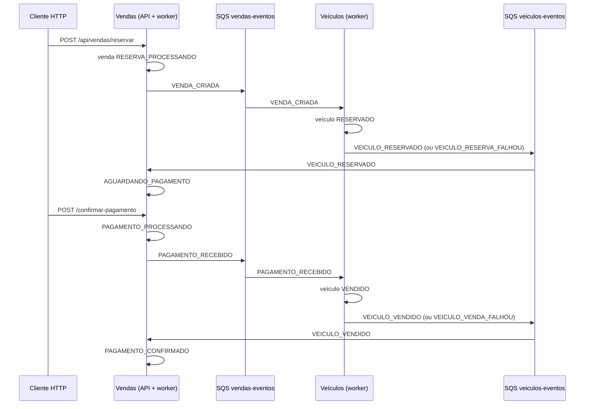

# soat13-tc-revenda-vendas

Serviço independente para reservas e vendas. Mantém apenas o banco de vendas,
consulta o cliente pela API HTTP de clientes e coordena a disponibilidade do
veículo com o serviço de veículos por uma **saga coreografada** sobre filas SQS.
Não compartilha código, banco, volume ou rede Docker com os outros serviços.

As colunas `cliente_id` e `veiculo_id` guardam somente os identificadores recebidos por API; não há chaves estrangeiras ou conexão com os bancos dos outros serviços.

Visão geral do sistema (AWS, Clean Architecture e saga): [documentação de arquitetura (PDF)](https://github.com/mgustavocoder/soat13-tc-revenda-infra-k8s/blob/main/docs/arquitetura-seguranca-saga.pdf).

## Executar

```bash
cp .env.example .env
docker compose up -d --build
```

O serviço fica disponível em `http://localhost:3003`; o MySQL deste projeto usa a porta `3309`. Para executar sem Docker, configure a URL de clientes e as filas no `.env`, instale com `npm install` e inicie com `npm start` (API) e `npm run worker` (consumidor da saga).

As credenciais `root/root` do `.env.example` são somente para desenvolvimento
local. Não reutilize em produção, não versione o arquivo `.env` e nunca coloque
credenciais AWS no projeto.

Ao usar Docker Compose localmente, a URL padrão acessa o serviço de clientes publicado no host (`host.docker.internal`). Em outro ambiente, defina `CLIENTES_SERVICE_URL` para a URL HTTP acessível pelo container. O serviço não chama mais a API de veículos.

## API

- `GET /api/health`
- `GET /api/vendas`
- `GET /api/vendas/:codigo` para consultar o processamento
- `POST /api/vendas/reservar` com `{ "veiculoPlaca": "ABC1D23", "clienteCpf": "12345678901" }` (responde `202 Accepted`)
- `POST /api/vendas/:codigo/cancelar`
- `POST /api/vendas/:codigo/confirmar-pagamento` (responde `202 Accepted`)

Reserva, confirmação de pagamento e cancelamento respondem imediatamente;
consulte o `status` pelo código da venda até chegar a `AGUARDANDO_PAGAMENTO`,
`PAGAMENTO_CONFIRMADO`, `CANCELADA` ou um estado de falha (o campo `erro` traz o
motivo). Um cliente inexistente é rejeitado com `404` antes de a saga começar;
falta de fila ou do serviço de clientes resulta em `503`.

## Saga coreografada

Não existe orquestrador: vendas executa a sua transação local, publica um
evento na fila `vendas-eventos` e reage aos eventos que veículos publica na fila
`veiculos-eventos`. Vendas não chama a API de veículos.



| Evento recebido (`veiculos-eventos`) | Reação de vendas |
|--------------------------------------|------------------|
| `VEICULO_RESERVADO` | `RESERVA_PROCESSANDO → AGUARDANDO_PAGAMENTO`, grava `veiculoId` e `preco`. Se a venda já estiver encerrada (`RESERVA_FALHOU`/`CANCELADA`), publica `VENDA_CANCELADA` para compensar a reserva |
| `VEICULO_RESERVA_FALHOU` | `RESERVA_PROCESSANDO → RESERVA_FALHOU` com o motivo |
| `VEICULO_VENDIDO` | `PAGAMENTO_PROCESSANDO → PAGAMENTO_CONFIRMADO` |
| `VEICULO_VENDA_FALHOU` | `PAGAMENTO_PROCESSANDO → PAGAMENTO_FALHOU` (permite nova confirmação ou cancelamento) |
| `VEICULO_LIBERADO` | Apenas registra a conclusão da compensação |

Compensações:

- **Cancelamento** (`AGUARDANDO_PAGAMENTO` ou `PAGAMENTO_FALHOU`): a venda vai
  para `CANCELADA` e publica `VENDA_CANCELADA`; veículos libera a reserva.
- **Falha ao publicar** um evento: a venda volta ao estado anterior (ou vai para
  `RESERVA_FALHOU` na reserva) e a API responde `503`.
- **Reserva tardia** para venda já encerrada: vendas publica `VENDA_CANCELADA`.

Garantias e limites:

- As filas são standard (entrega pelo menos uma vez). Cada handler só age se a
  venda estiver no estado que espera aquele evento, então duplicatas são
  ignoradas; atualizações usam controle otimista (`WHERE status = ?`).
- Mensagens inválidas são descartadas; erros transitórios voltam para a fila e,
  depois de 5 recebimentos, vão para a DLQ.
- A gravação no banco e a publicação do evento não são atômicas. As
  compensações acima cobrem a falha de publicação; um transactional outbox
  seria o próximo passo para eliminar esse risco por completo.
- A restrição `uq_vendas_veiculo_ativo` impede duas vendas ativas para o mesmo
  veículo já na criação (`409`).

## Arquitetura

O código segue Clean Architecture; as dependências apontam sempre para dentro
(infraestrutura → aplicação → domínio):

```
src/
├── domain/
│   ├── entities/
│   │   ├── venda.js                # Entidade, StatusVenda e máquina de estados
│   │   └── value-objects/          # CodigoVenda, Cpf, Placa
│   └── errors/                     # InvalidInput, NotFound, Duplicate, BusinessRule
├── application/
│   ├── errors/                     # ServiceUnavailableError
│   ├── gateways/                   # Portas: repositório, clientes, publisher e contratos de eventos
│   └── usecases/
│       ├── venda-usecase.js        # Comandos: reservar, confirmar pagamento, cancelar
│       └── venda-saga-usecase.js   # Reações aos eventos de veículos
└── infrastructure/
    ├── api/                        # Express (app.js, server.js, erros → HTTP)
    ├── controllers/                # Controllers, wire-in e factory
    ├── datasource/                 # MySQL
    ├── gateways/                   # Cliente HTTP do serviço de clientes
    └── messaging/                  # SqsProducer, SqsConsumer, worker.js
```

Testes: `npm test` (unitários de domínio, casos de uso e consumidor SQS, além de
testes de integração da API e da saga com banco e SQS simulados).

O endpoint de confirmação registra a confirmação do pagamento no fluxo de
venda; não há integração com um provedor financeiro nem armazenamento de dados
de cartão. A venda armazena CPF e placa para relacionar a operação.

## AWS

O deploy de produção usa a imagem deste serviço no ECR e o manifesto Kubernetes
mantido em `soat13-tc-revenda-infra-k8s`. A consulta a clientes usa o Service
interno do Kubernetes, não URLs públicas; a integração com veículos é feita só
pelas filas SQS, com IRSA. Consulte o README da
infraestrutura para provisionamento e deploy. Não configure chaves AWS dentro
do projeto.

## Repositórios relacionados

- [Clientes](https://github.com/mgustavocoder/soat13-tc-revenda-clientes)
- [Veículos](https://github.com/mgustavocoder/soat13-tc-revenda-veiculos)
- [Infraestrutura de banco](https://github.com/mgustavocoder/soat13-tc-revenda-infra-db)
- [Infraestrutura EKS e API Gateway](https://github.com/mgustavocoder/soat13-tc-revenda-infra-k8s)
- [Arquitetura, segurança e Saga (PDF)](https://github.com/mgustavocoder/soat13-tc-revenda-infra-k8s/blob/main/docs/arquitetura-seguranca-saga.pdf)
